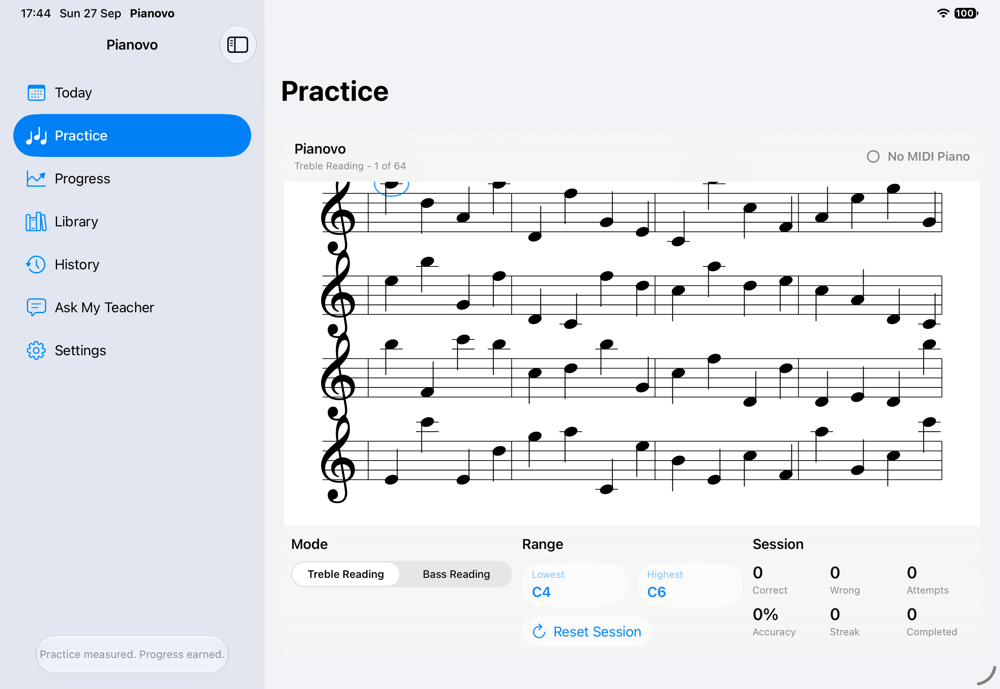
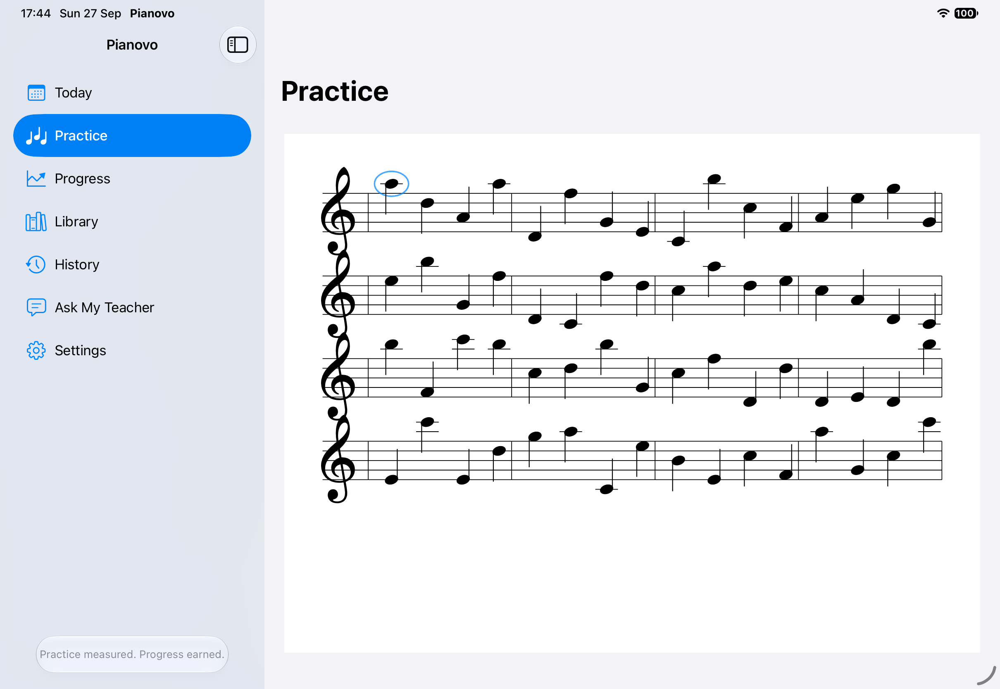

# Pianovo

*Practice measured. Progress earned.*

Pianovo is a native SwiftUI piano-practice app for iPhone and iPad. Today provides a saved programme plan, while Practice turns a physical MIDI piano into an interactive sight-reading exercise: the app generates notation, listens for played notes through CoreMIDI, and advances only when the learner plays the expected pitch.

The project began with a personal learning problem. Static sheet music shows *what* to play, but it does not organise practice, measure the attempt, or help a learner and teacher agree on what comes next. Pianovo combines a working MIDI practice loop with a Today experience for starting a structured twelve-week programme and viewing its saved day. Progress history, document access, and teacher-guided planning remain future workflows supported by implemented foundations.

> **Development status:** active portfolio project. Today, Practice, and the private local exercise Library are user-facing. Milestone 6F.4 connects Today’s generated sight-reading assignments to MIDI Practice and saved session records. Milestone 6F.5 adds explicit learner-reported assignment completion and undo. Programme advancement, document access, and teacher workflows remain planned.

## App preview

| Practice controls | Distraction-free score |
| --- | --- |
|  |  |

Both images are direct captures of the running app on an iPad Pro 11-inch (M5) simulator. The disconnected MIDI state is expected in the simulator.

## What works today

### Today programme experience

- Opens as the initial destination, with an explicit **Start Programme** action that initializes the twelve-week programme at **Week 1, Day 1**.
- Persists and restores the current programme position across app launches; repeated starts preserve existing progress, and calendar dates do not advance the saved day.
- Shows **Morning** and **Evening** practice sections, plus a distinct recovery/reflection-day presentation for saved recovery days.
- Presents assignment goals, planned duration, and completion/mastery status when records exist.
- Begins Beyer work at **Op. 101 No. 63**, with **Seconda** and **Prima** shown as required components of one exercise.
- Represents reference-material availability honestly, keeping assignments visible even when documents are unavailable.
- Provides structured loading, unavailable, and failure states, with retry where appropriate.
- Uses responsive native iPhone/iPad layouts, including two columns at suitable widths, Dynamic Type, and VoiceOver labels.

### Self-reported assignment completion

- **Mark complete** and **Undo completion** work for every assignment in the current saved day, including outside-app practice and recovery/reflection work.
- Beyer No. 63 requires confirmation that both **Seconda** and **Prima** were practised before completing the one assignment.
- Completion status persists across app launches. Failed changes support retry or a fresh read of Today.
- Completion is the learner’s report, not an assessment of mastery. Undo returns the assignment to Not started while preserving practice history and mastery status.

Completion is separate from saving a session and does not advance programme position.

### Assigned sight-reading sessions

- Launch a generated sight-reading assignment from Today, review its goal and planned duration, and choose Treble/Bass and a natural-note range before **Start Session**.
- Practise with MIDI input using the existing notation and statistics; mode, range, and reset controls are locked during the assigned session.
- **End & Save** stores the assignment context, start/end times and local-day context, and a stopped outcome, then shows an immediate summary of the actual session statistics.
- Retry a failed save using the same session identity. Backgrounding freezes the session; returning offers save or discard without resuming or counting background time.

Only generated sight-reading assignments are actionable; other assignments remain informational. Saving does not mark an assignment complete, evaluate mastery, or advance the programme. Numeric statistics remain temporary, and Today cannot open reference documents.

### MIDI sight-reading Practice

- Continuous single-staff **Treble Reading** and **Bass Reading** exercises.
- Responsive notation arranged into measures and systems on a paper-like practice surface.
- Quarter notes, stems, barlines, ledger lines, and a highlighted current event.
- Configurable natural-note ranges: C4-C6 for treble and C2-C4 for bass.
- Physical piano input through CoreMIDI, validated with a Yamaha P-45 and iPad.
- Correct notes advance the exercise; incorrect notes keep the current event active.
- A new 64-note exercise is generated after the current exercise is completed.
- Session-only counts for correct answers, wrong attempts, accuracy, streak, and completed prompts.
- Adaptive iPhone/iPad layout and an auto-hiding practice HUD that does not reflow the score.

Practice remains directly available from navigation. Progress, History, Ask My Teacher, and Settings remain placeholder destinations with “coming later” states.

### Private local exercise Library

- Create exercises with a title, category, instructions, and learning purpose.
- Browse/search, view details, edit, archive, and restore them from the Archived list.
- Retain stable exercise identity and earlier saved revisions across edits and app launches.
- Retry failed writes or refresh to check durable saved status.

Library exercises are private written guidance on the device. They do not yet launch MIDI Practice or appear in Today. Programme editing, document import, teacher sharing, cloud sync, and AI coaching remain planned. Exercise creation, archiving, and restoration have been manually validated.

### Reusable exercise templates

- Create or edit private templates with a name and exercise defaults; optionally begin with a Pianovo starter pattern.
- Browse/search, archive, and restore templates in Library → Exercise templates.
- **Create exercise** opens a pre-filled form you can adapt before saving an independent exercise.
- Preserve the source template version as origin; later template changes leave existing exercises untouched.

Templates contain written defaults, not automatically generated notation or programme assignments. Programme templates, scheduling, sharing, and AI remain future work. The Library V1-to-V2 migration preserves existing exercises and revisions. Manual validation confirmed template navigation and exercise creation from a template.

## Implemented foundations

These implemented and tested components support the app and future work; their presence does **not** imply complete user-facing workflows:

- A framework-independent Music Domain and Full Score Domain with stable event identifiers.
- A limited MusicXML `score-partwise` importer.
- Development-only full-score rendering of MusicXML fixtures with Verovio.
- A validated twelve-week programme model used by Today; programme progression controls remain deferred.
- SwiftData repositories for programme progress, sessions, attempts, reflections, and mastery decisions.
- A logical reference-material catalogue that keeps licensing and file availability explicit.
- Production dependency composition and Today presentation state, now connected to the working Today screen.

This distinction is deliberate: having a persistence model or view model in the codebase does not mean learners can already use the corresponding feature in the app.

## Engineering highlights

- **Native interaction:** SwiftUI and CoreMIDI provide a responsive practice loop with physical-instrument input.
- **Separated domains:** music, practice behaviour, curriculum, progress, rendering, and infrastructure have explicit boundaries.
- **Renderer strategy:** lightweight native notation supports interactive drills; Verovio is isolated behind a separate adapter for future full scores.
- **Stable identity:** score events, programme elements, assignments, and persisted records use deterministic identifiers.
- **Local-first persistence:** SwiftData is confined to an adapter layer behind asynchronous repository protocols.
- **Deterministic tests:** injected clocks, time zones, calendars, random sources, and in-memory stores avoid dependence on device state.
- **Responsible source handling:** reference PDFs and audio are not committed or bundled while usage rights remain unverified.

## Technology

- Swift, SwiftUI, and Swift Testing
- CoreMIDI
- SwiftData with a versioned schema and migration-plan scaffold
- Foundation `XMLParser` for the supported MusicXML subset
- Native SwiftUI/Core Graphics notation with the bundled Bravura SMuFL font
- Verovio through Swift Package Manager for development-facing full-score rendering
- WebKit, isolated to the Verovio SVG debug view

## My role

I created Pianovo to combine my experience in learning design with hands-on product and software development. I defined the learner problem, product direction, milestones, acceptance criteria, architecture boundaries, and test strategy; guided the iterative Swift implementation; reviewed each change; and validated MIDI behaviour on a Yamaha P-45.

The implementation has been developed with Codex as an AI coding collaborator. My contribution is therefore best described as product ownership and AI-assisted engineering: translating a real learning need into technical requirements, evaluating trade-offs, testing the result, diagnosing integration issues, and maintaining the product and repository documentation.

## Build and run

### Requirements

- A Mac with Xcode and an iOS/iPadOS 26.5 SDK or later.
- iOS/iPadOS deployment target 26.5.
- An iPhone or iPad simulator for the interface, or a compatible physical device for CoreMIDI input.
- Optional: a class-compliant MIDI piano and the appropriate USB connection. The hardware path has been validated with a Yamaha P-45 connected by USB-B to USB-C.

No API key is required for the current build. Verovio resolves automatically through Swift Package Manager at the revision pinned in `Package.resolved`.

### Xcode

1. Clone the repository: `git clone https://github.com/winlnist/pianovo.git`.
2. Open `Pianovo.xcodeproj`.
3. Select the shared `Pianovo` scheme.
4. Choose an iPhone/iPad simulator or a configured physical device.
5. Build and run.

For the most reliable physical MIDI startup sequence, connect the cable, power on the piano, and then launch Pianovo.

### Command line

Replace the destination when that simulator is not installed locally:

```bash
xcodebuild \
  -project Pianovo.xcodeproj \
  -scheme Pianovo \
  -destination 'platform=iOS Simulator,name=iPad Pro 11-inch (M5)' \
  build

xcodebuild \
  -project Pianovo.xcodeproj \
  -scheme Pianovo \
  -destination 'platform=iOS Simulator,name=iPad Pro 11-inch (M5)' \
  test
```

### Verified baseline

Milestone 6F.4 completed a clean simulator build and all **213 tests across 22 suites passed** using an iPad Pro 11-inch (M5) simulator. The existing Practice portfolio captures were produced from the running app on iPadOS 27.0.

The Today experience was manually validated on a physical iPad: initial navigation, explicit start at Week 1 Day 1, Morning/Evening sections, Beyer No. 63 with Seconda and Prima, honest document availability, position restoration after reopening, and portrait/landscape layouts. Practice remained operational.

The current Practice experience was also manually verified on 27 September 2026 using a physical iPad Pro with an M5 processor and a Yamaha P-45 digital piano connected directly by a USB-B to USB-C cable for USB MIDI. Pianovo received the played notes, correctly played notes advanced the sight-reading exercise, and session statistics updated, confirming that the core Practice workflow operated successfully on physical hardware.

The 6F.4 assigned sight-reading flow was also manually validated on a physical iPad with a Yamaha P-45: preparation, session start, MIDI input and statistics, assigned-session controls, End & Save and its immediate summary, return to Today with programme position preserved, and the tested interruption/background behaviour. Standalone Practice remained operational.

Milestone 6F.5 automated verification passed **231 tests across 23 suites**, including completion/undo restoration and save-failure handling. The completion controls were also manually validated on a physical iPad: marking complete, undoing completion, restoration after reopening, required Beyer parts, and independence from assigned-session saving.

Milestone 6F.7 automated verification passed **255 tests across 26 suites** and a clean simulator app build. Library validation covers disk restoration, immutable revisions, failed-save retry, stale edits, archive/restore, and preservation of the existing progress store. Manual validation confirmed exercise creation, archiving, and restoration.

Milestone 6F.8 automated verification passed **269 tests across 28 suites** and a clean simulator build, including a real V1-to-V2 Library migration and independent exercise creation from template revisions. Manual validation confirmed template navigation and exercise creation from a template.

## Current limitations

- Practice is single-staff and one note at a time; there is no mixed grand staff, two-hand, chord, or rhythm-aware practice yet.
- Generated exercises use natural pitches and quarter-note notation rather than full musical context.
- Assigned sight-reading saves session context and times, but numeric statistics remain temporary. Standalone Practice does not save sessions.
- Today has no automatic mastery evaluation or controls to advance programme position.
- Unsaved assigned sessions cannot be recovered after the app closes; force-quit recovery is deferred.
- Progress, History, Ask My Teacher, and Settings remain placeholder screens.
- Today cannot open, import, crop, or display the Beyer PDF; reference-material availability is informational.
- MusicXML importing and Verovio rendering are development foundations without a production file picker or interactive-song UI.
- PDF/photo import, optical music recognition, audio or raw MIDI performance recording, tempo/rhythm analysis, teacher accounts and teacher-created plans, Ask My Teacher chat, coach API, cloud sync, and collaboration remain planned workflows.
- MIDI reconnect/hot-plug behaviour needs more real-device hardening.
- The project retains known compiler-warning cleanup tasks despite the green build and test suite.

## Next milestones

1. Add programme templates and editable learner plans; define progression separately from completion and mastery.
2. Introduce document access and licensed/user-imported reference-material presentation.
3. Add score-aligned MIDI timing and correctness analysis.
4. Build learner progress and teacher planning workflows before considering accounts or cloud sync.

See the detailed [roadmap](docs/ROADMAP.md) for completed milestones and longer-term work.

## Documentation

- [Product](docs/PRODUCT.md) — problem, audiences, present experience, and product direction.
- [Architecture](docs/ARCHITECTURE.md) — layers, dependencies, adapters, and persistence boundaries.
- [Roadmap](docs/ROADMAP.md) — completed milestones and planned work.
- [Music Domain](docs/MUSIC_DOMAIN.md) and [Score Domain](docs/SCORE_DOMAIN.md) — musical concepts and full-score model.
- [Practice Engine](docs/PRACTICE_ENGINE.md) — exercise generation, matching, and statistics.
- [Programme Domain](docs/PROGRAMME_DOMAIN.md) — twelve-week structure and mastery rules.
- [Content and Programmes](docs/CONTENT_AND_PROGRAMMES.md) — planned reusable exercises/templates, individual plans, and future sharing/backend boundaries.
- [Persistence and History](docs/PERSISTENCE_AND_HISTORY.md) — stored records, schema, and deletion semantics.
- [Reference Materials](docs/REFERENCE_MATERIALS.md) — logical catalogue and document-access boundaries.
- [Import Pipeline](docs/IMPORT_PIPELINE.md) — MusicXML support and future PDF/photo recognition.
- [Contributor guidance](AGENTS.md) — constraints for future development work.
