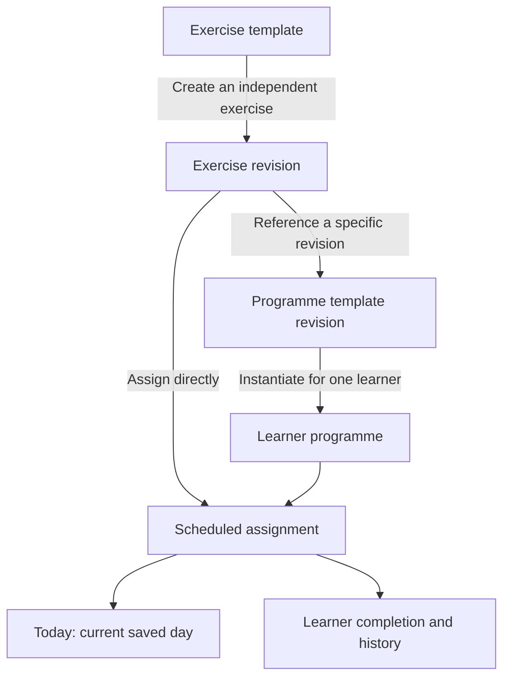

# Reusable Content, Programmes, and Sharing

## Status and direction

Milestone 6F.6 records the agreed product direction and proposed architecture on 12 October 2026. This document records future design and the separate 6F.7 local Library implementation boundary. Programme-template editing is implemented locally in 6F.9 with device validation pending; a backend and sharing services are not implemented.

Pianovo should support teachers organising work for students and learners organising their own work, including with AI coaching. Both paths use reusable exercises, exercise templates, programme templates, and individual learner programmes. A later community can distribute free or paid material and reward creators.

Today and Practice are working through 6F.5. Milestone 6F.7 implements the private local exercise Library described below; creation, archive, and restore were manually validated. Progress, teacher accounts, AI coaching, cloud synchronisation, payments, and community publishing remain future workflows. The current exercise-source catalogue is code-defined metadata; it is not an editable exercise database. The original SwiftData store holds progress and history. A separate Library store now holds authored exercises and saved revisions; exercise templates are completed in 6F.8, with template navigation and exercise creation from a template manually validated; programme templates are implemented locally in 6F.9 with device validation pending. Local History/private notes are implemented in 6F.11 with device validation pending.

## Shared content model

These are conceptual entities across the roadmap. Exercises and exercise templates now have local implementations; programme templates have a local editor; learner-programme integration is implemented locally in 6F.10 with device validation pending.

| Entity | Responsibility | Example |
| --- | --- | --- |
| Exercise template | A reusable starting pattern with defined configurable fields or defaults | Scale warm-up with a key and instructions |
| Exercise | A specific activity authored from scratch or instantiated from an exercise template | Relaxed C-major scale practice |
| Programme template | A reusable arrangement of exercise revisions into ordered weeks, days, and sections | A beginner practice plan |
| Learner programme | An independent plan instantiated for one learner, from a template or from scratch | A student's adapted beginner plan |
| Assignment | One scheduled occurrence of an exercise within a learner programme | Week 1, Day 2, Morning: practise the scale for ten minutes |
| Progress and history | The learner's completion, sessions, reflections, and later assessment evidence | Day 2 completion and saved session |

An exercise owns reusable content: title, instructions, category, learning purpose, optional logical material references, and supported delivery metadata. An assignment owns contextual instructions or goal overrides, planned duration, order, and placement. Reusing an exercise never shares completion between assignments.

Exercise templates and exercises remain distinct: changing a template does not rewrite exercises already created from it. Programme templates and learner programmes remain distinct for the same reason. A teacher, learner, or AI-assisted authoring flow can create content without requiring a separate curriculum model for each role.

Example: create a C-major warm-up once, place it in Day 1 and Day 2 of a template, then instantiate the template for two students. The four resulting assignments have separate identities and progress. Adapting one student's Day 2 goal affects neither the other student nor the original template.

## Today, weeks, and programme position

Today is the learner-facing projection of the current saved day in an individual programme. It displays assignments rather than embedding exercise content in SwiftUI. The future editor places exercises into weeks, days, and sections; Library manages reusable content.

The twelve-week seed, six practice days plus one recovery day, and Morning/Evening structure are starter defaults. Future programmes can have different lengths, including six months or one or two years. Programme length and practice-day structure must be validated as content, rather than fixed global constants. Current local authoring bounds are specified in the 6F.9 section below; date-based scheduling remains a future decision.

Programme days describe ordered work. Calendar date and time of day do not advance the programme. Repeating an exercise, completing an assignment, saving a session, changing the current day, and demonstrating mastery are distinct actions.

6F.10 implements explicit day navigation for independent learner plans, preserving incomplete work/history, disclosing unfinished assignments, handling recovery/week boundaries, and presenting a final-day state. The original seeded programme remains unchanged. It must not infer mastery or select the next Beyer exercise merely from a day/week change. The existing later-week current-Beyer source is unresolved metadata, not an implemented adaptive exercise selector.

## Identity, versions, copies, and updates

The following rules are the design baseline for local authoring and future sharing:

- Allocate opaque stable entity and revision identifiers locally; they must remain usable after synchronisation. Do not derive identity from a title, display name, array index, date, or server-only database key.
- Saved content revisions referenced by assignments or published templates are immutable. Saving an edit creates a new revision; drafts are editable working copies.
- Retain origin entity/revision and creator attribution when instantiating or adapting content. A copy has its own identity and owner. It must not falsely claim the original creator endorsed the adaptation.
- A programme template references specific exercise revisions. An instantiated learner programme resolves those references into its own stable plan/assignment identities, retaining the source template revision.
- Each occurrence of an exercise has a separate assignment identity, including repeats on the same day. Separate learners and repeated uses of a programme template must not collide in progress storage.
- Template or exercise updates are offered explicitly. They must not silently replace assigned work or change the meaning of existing completion/history records.
- Applying an update produces a new plan revision and describes the affected assignments. Replacement work gets new assignment identities; existing historical references remain resolvable. The precise reconciliation UI is a later milestone.
- Archive referenced content instead of removing the revisions needed to interpret history. Hard deletion, account deletion, retention, and acquired-content access after creator withdrawal need explicit later policies.

Content ownership, author attribution, and access rights are separate. A local owner identity can later be linked to an authenticated account without changing content IDs. A teacher's name is display metadata, not an ownership or authorisation key.

## Local database and future hosted service

The first Library uses a real local database behind a content repository boundary. It is the first adapter for the shared model, not a mock database or a UI-only array intended to be replaced wholesale.

Planned boundaries:

| Boundary | Responsibility |
| --- | --- |
| Content/programme domain | Identity, revision references, validation, instantiation, and scheduling rules |
| Application services | Authoring, copying, explicit update adoption, and learner-facing actions |
| Local persistence adapter | SwiftData storage, transactions, schema versions, offline reads/writes |
| Future API/sync adapter | Serialisation, authentication, transfer, reconciliation, and durable acknowledgement |
| Hosted service | Accounts, access enforcement, shared/published content, programme distribution, authorised progress sharing |
| File/material adapter | Device access and availability of referenced documents, separate from catalogue content |

Domain types must remain independent of SwiftUI, SwiftData, HTTP clients, AI SDKs, and hosting vendors. Views consume application state. New content repositories must not overload the existing progress/history protocols.

The hosted system will eventually retain shared exercises and templates, account profiles, teacher/student relationships, programme assignments, and authorised notes/progress. Actual document/media storage and access are separate from database metadata. A catalogue reference does not make a PDF available, confer distribution rights, or make arbitrary instructions MIDI-assessable.

The iPad retains usable content and supports practice offline. Before remote rollout, define an outbox of pending local changes, idempotent operations, revision-based conflict checks, retry/backoff, explicit sync status, and account isolation. Network loss must not appear as successful remote delivery; teacher updates should be visibly pending until acknowledged.

Published immutable revisions avoid silent content merging. Conflicting edits to mutable drafts, plans, relationships, and notes require explicit reconciliation; device clocks alone must not determine which important edit wins. Permission changes and revoked relationships require a server-enforced access policy plus a defined policy for cached/offline data.

No backend provider, new dependency, authentication library, API, sync engine, or payment provider is selected or implemented by this milestone. These choices follow the access, data, offline, and operating-cost requirements.

## Teacher, learner, and AI workflows

### Teacher-guided learning

A teacher authors exercises/templates, adapts a plan for a student, and explicitly publishes assignments or updates. A student follows their own programme on their iPad. Authorised teacher review can show recorded practice before a lesson, support discussion and notes during the lesson, and inform the next plan revision.

An invitation/accepted relationship and permissions are required for cross-account access. Acquiring a teacher's template does not automatically create a teacher/student relationship or grant that teacher access to progress.

### Independent learning and starter content

A learner can start without a human teacher, using starter exercise templates, exercises, and programme templates. They can create/adapt their own material and later request AI guidance. A teacher account or relationship must not be a prerequisite for self-learning.

The current seed programme is a candidate starter template. It cannot be converted or reassigned silently: existing stable IDs, saved position, completion, and history must survive a tested migration.

### AI coaching and authoring

AI is both an authoring aid for teachers and a learner-facing coach for independent learning. It can propose exercises/programmes, explain tasks, answer questions, and suggest adjustments based on goals, available time, learner feedback, and actual evidence available to Pianovo.

Use the same domain entities for manual and AI-assisted content. Generation produces a validated draft with origin metadata; the teacher or learner reviews and accepts it before it becomes assigned work. Generated text must not automatically become notation, supported Practice content, mastery evidence, a published community resource, or a programme change.

A future backend API can mediate generation and coaching; an assistant interface in the app does not require an autonomous agent in the first version. Provider credentials and privileged actions belong on the server. AI requests use explicitly permitted information and remain behind adapters. The self-learner AI path can proceed once its required backend/access controls exist, without depending on completion of every teacher-collaboration feature.

Current MIDI practice checks expected pitches. It does not establish rhythm, fingering, posture, or general musical mastery, and numeric statistics are currently temporary. AI guidance must distinguish observed evidence, self-reported completion, and unsupported assumptions. Missing assessment data must not be fabricated.

## Notes, privacy, and future community

Planned note types include private learner reflections, student-visible teacher feedback, private teacher lesson notes, and shared lesson notes. Author, subject learner/programme context, audience, and revision history must be explicit. Notes need their own workflow; marking an assignment complete must not create an invented reflection or lesson note.

The design default is private content and private learner progress. Shared teaching material and personal student data occupy separate access boundaries. Role labels on the device do not grant authority: the hosted service enforces per-resource access. Changing a relationship must not expose another student's programme or notes. Detailed permissions, retention, account-linking, and offline revocation policy must be settled before remote deployment.

A future community can publish free or paid exercises and both kinds of templates. Learners can acquire programmes for independent study, teachers can acquire/adapt teaching material, and users may contact creators about lessons. Creator attribution, publication version, and permissions for personal use, teaching use, adaptation, and redistribution must be explicit. Permission to adapt does not inherently include permission to resell or distribute an adapted copy.

Starter/free access, paid continuation, AI subscriptions or usage limits, template purchases, and creator compensation are product options. Pricing, payouts, moderation, content quality review, contact mechanisms, and purchase/withdrawal rules are undecided. No commercial entitlement is inferred from a local content flag. Third-party materials remain subject to their separately recorded availability and rights status.

## First implementation: local exercise Library (6F.7)

The first implementation is a deliberately small local authoring workflow:

- Define framework-independent exercise identity, immutable saved revisions, optional origin attribution, and structured validation.
- Store private exercises durably through a local content repository and versioned SwiftData adapter.
- Replace only the Library placeholder with list, detail, create, edit, and archive actions.
- Create exercises from scratch with a title, category, instructions, and learning purpose; display any logical reference and its availability honestly.
- Keep initial authored exercises as guidance. Do not make free-text instructions playable or replace them with random sight-reading. Practice support needs a separately validated delivery adapter.
- Preserve referenced revisions when editing/archiving; show save failures and retry without false success.
- Verify offline restoration, revision identity, validation, failed saves, archive behaviour, and preservation of the existing Today/Practice/progress store.

Exercise-template creation, programme scheduling, replacing the active seed plan, document import, generated notation authoring, accounts, network sharing, AI, notes UI, and payments are later milestones. Their identity/version boundaries are designed here; their whole schemas and services need not be implemented in 6F.7.

### 6F.7 storage decision and implementation boundary

Use a separate named `PianovoLibrary` SwiftData configuration, explicitly stored as `PianovoLibrary.store` in application support, with `LibrarySchemaV1` and `LibraryMigrationPlan`. CloudKit is explicitly disabled; this is local storage, not implemented cloud sharing. V1 is the original 6F.7 schema; 6F.8 explicitly upgrades this same store to V2 as described below. The existing progress schema, migration plan, identifiers, and default store are unchanged. The two containers bootstrap independently and remain retained by app dependencies; a failure in one does not disable the other or silently select an in-memory production fallback.

Library stores have exercise headers, immutable revision payloads, and one persistent local owner identity created with the first successful exercise write. UUID-based content/owner/revision identities survive edits, archives, and relaunches. The owner is an installation-local content identity, not a fabricated teacher account or authority to claim a remote account.

`LibraryExerciseRepository` is an explicitly MainActor, async/throwing application boundary so SwiftData access stays confined. Domain values, validation, and mutation rules are Foundation-only. SwiftData uses isolated writer contexts with autosave disabled, rollback on failure, fresh durable verification, and optimistic expected-revision checks. Retrying the exact create/revision/archive request is idempotent; changed or conflicting identities are rejected. Parent revision links define order even if device time changes. Future schema/payload changes require migration planning.

The screen offers list/search, Active/Archived views, detail, create/edit forms, archive, and restore. New exercises contain written guidance only. Logical material references are preserved and labelled without claiming access; the initial form does not import documents or attach new reference files. Cancel performs no write; closing after an ambiguous save does not delete a change that reached storage. An explicit or post-editor refresh reads durable state.

The initial workflow has no programme-editor scheduling, no generated notation authoring, no learner completion in Library, no AI, accounts, networking, payments, or history mutation. 6F.8 adds exercise templates separately. Preview/test repositories are in memory; production content is not seeded with demonstration exercises.

## Compatibility and implementation gates

The current `PracticeProgramme`, `PracticeAssignment`, and `ExerciseSource` types remain unchanged in this design task. An `ExerciseSource` is source metadata, not a substitute for an authored exercise/revision. The 6F.10 learner-plan projection supplies its own resolved content to Today while preserving these legacy types and framework boundaries.

Current progress records refer to a programme definition/version and assignment IDs; they do not yet model separate learner programme instances or exercise revisions. 6F.10 introduces independent instance/revision references and a tested coexistence path, leaving legacy progress in its original store. Before any later cross-account or seed-conversion work, specify and test the additional compatibility mapping. Do not reuse template assignment IDs as learner assignment IDs. Do not reinterpret legacy progress as belonging to a newly created plan.

The following remain open before their respective implementations: exact template fields/configuration, programme editor limits, next-day/end-of-programme policy, active-plan revision adoption and legacy-progress migration, hosting/authentication provider, sync conflicts, note-sharing permissions, commercial terms, and AI provider/access policy.

## Exercise templates implementation scope (6F.8)

The first template workflow stores a name and validated exercise defaults (title, category, instructions, learning purpose, and any already-linked logical material reference). Using a template opens an exercise draft that can be adapted before saving. It creates a new exercise identity and pins the source template revision/name; later template edits cannot rewrite created exercises. Free text remains guidance, not generated notation. A variable-substitution language, score authoring, programme scheduling, and AI remain deferred.

Add immutable template revisions, archive/restore, and optional labelled starter patterns for warm-up, sight-reading guidance, and reflection. Starter patterns prefill a private template draft only when requested; they are not automatically inserted into the user's database or presented as measured exercises.

Evolve the existing Library store explicitly from `LibrarySchemaV1` to `LibrarySchemaV2` with a lightweight migration adding template headers/revisions while retaining the original three model definitions unchanged. Templates share the store's persistent local owner identity. Test a real V1 disk store upgraded to V2, including old exercise IDs, owner, revisions, archive state, and legacy payloads. Progress/history V1 remains unchanged.

Exercise revision payloads gain optional typed template-origin metadata; decoding legacy payloads without that key must succeed with nil origin. This additive payload extension does not rewrite old revisions or substitute exercise/template IDs. Future incompatible payload changes still require migration design. Template writes use isolated transactions, durable verification, expected revisions, and frozen idempotent retry as exercise writes do.

## Programme templates implementation scope (6F.9)

Library → Programme templates provides private create/detail/edit/copy/search/archive/restore. A template contains ordered weeks and days, a recovery/reflection flag, and named sections. Each exercise placement has a unique UUID, a pinned authored exercise/revision reference, a contextual goal, and planned minutes. Array order defines presentation order; the editor supports explicit reordering and removal. Adding an exercise selects its current saved revision; old references remain pinned when the exercise is edited or archived.

Blank templates begin with one empty day. Optional one-week and twelve-week starter structures use six Morning/Evening days plus an empty recovery day; they do not seed exercises or convert the legacy Today programme. Empty sections/days can be saved to build a template gradually. Validation requires a name, 1–104 weeks, 1–7 days per week, at most 8 named sections per day, at most 100 placements per section, unique structural/placement identities, a nonempty goal, 1–1440 planned minutes, and resolvable exercise revisions. These are explicit local authoring bounds, not date-based scheduling or a global twelve-week programme policy.

Saving creates immutable revisions with expected-revision conflict checks. Copying allocates independent template/revision and week/day/section/placement identities, keeps exercise references pinned, and retains the source programme-template revision/name as origin. Subsequent edits preserve that origin. Archived exercises already referenced remain resolvable; new placements use active exercises. No hard deletion is offered.

`LibrarySchemaV3` adds programme headers/revision payloads to the same Library store with an explicit V2-to-V3 lightweight stage. V1 and V2 model definitions are unchanged; V1-to-current and exact V2-to-current disk migration tests preserve local owner, exercise/template identities, revisions and archive states. The programme repository verifies exercise references inside its local transaction and confirms durable writes using a fresh reader, with rollback and idempotent retries after failures. Progress/history schemas and stores are unchanged.

The programme-template editor alone produces reusable plans. 6F.10 adds explicit independent learner-plan creation and Today selection, as described in [Learner Programmes](LEARNER_PROGRAMMES.md). It does not convert the seeded Beyer programme, make authored text MIDI-playable, or introduce sharing, accounts, AI, payments or calendar scheduling.
